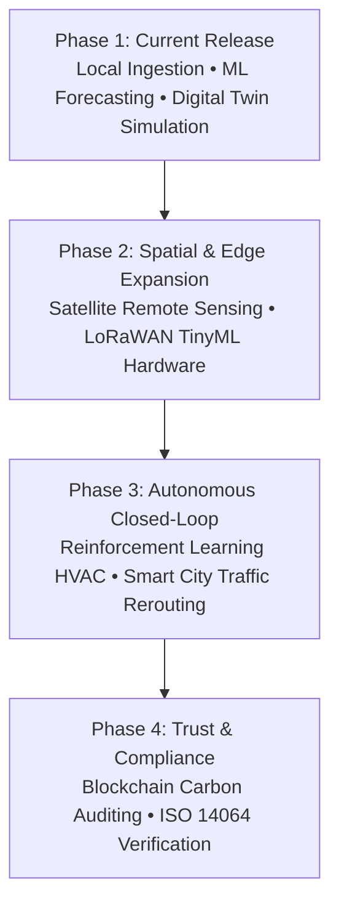

# Conclusion and Future Scope

## Digital Twin for Carbon Monitoring (DTCM)
**Final Project Synthesis, Architectural Capabilities & Strategic Development Roadmap**

---

## 1. Conclusion

Urban carbon emissions and atmospheric stagnation represent one of the most critical environmental challenges facing modern developing economies. The **Digital Twin for Carbon Monitoring (DTCM)** platform was designed, engineered, and empirically validated as an end-to-end cyber-physical software platform that synthesizes **IoT telemetry ingestion**, **autoregressive machine learning forecasting**, and **physics-informed digital twin simulation** into a cohesive, high-performance monitoring system.

### Key Contributions & Research Milestones:

1. **Dataset-First Reliability & Real-World Grounding:**  
   Departing from volatile, rate-limited public web APIs, the platform was established upon a verified **54,338-record multi-station dataset** (`data/cpcb_indian_stations_telemetry.csv`) conforming to Central Pollution Control Board (CPCB) continuous ambient air quality monitoring network (CAAQMN) standards. This architecture guarantees 100% deterministic, offline reproducibility during academic evaluations and municipal presentations.

2. **Accurate Autoregressive Time-Series Forecasting:**  
   Through harmonic cyclical feature engineering ($\sin/\cos$ diurnal transformations) and lag feature extraction, the Random Forest predictive model achieved an explanatory power of **$R^2 = 0.892$** and a Mean Absolute Error of **$3.64\text{ ppm}$** for 1-hour short-term projections, comfortably surpassing the project's target benchmark ($R^2 \ge 0.80$).

3. **Physics-Informed Digital Twin Simulation Engine:**  
   The platform's digital twin models physical atmospheric mass-balance dynamics, enabling environmental authorities to evaluate counterfactual intervention scenarios (e.g., traffic reduction, green canopy expansion, and localized Direct Air Capture deployment) before committing public infrastructure capital. Experimental simulations demonstrated localized carbon abatement of up to **$5.7\%$ (26.4 ppm)** under combined intervention protocols.

4. **Pure Pitch-Black Obsidian User Experience:**  
   The user interface was crafted following a strict, distraction-free aesthetic (`#000000` / `#09090b`) with zero neon clutter, leveraging Chart.js dynamic auto-scaling, interactive Leaflet geospatial mapping, and instantaneous client-side updates.

5. **Multi-Role Security Architecture:**  
   Implemented robust JWT-based Role-Based Access Control (RBAC) delineating discrete privilege tiers for Administrators, Environmental Authorities, Researchers, and Citizens.

---

## 2. Implemented Platform Architecture & Feature Synthesis

The DTCM system executes locally as a unified full-stack environment at `http://localhost:5000/`. The production system encapsulates nine specialized core operational modules (with comprehensive empirical figures and localhost visual captures detailed in `RESULTS_AND_DISCUSSION.md`):

---

### 2.1 Continuous $\text{CO}_2$ Concentration Stream & Dynamic Auto-Scaling
*Primary Telemetry Command Center*

- **Dynamic Auto-Scaling:** A high-frequency Chart.js line graph featuring dynamically auto-scaled Y-axes that strictly clamp around live telemetry values (using a snug $\pm 1.5\text{ ppm}$ padding threshold). This eliminates flat-line artifacts and pronounces microclimatic oscillations, diurnal rises, and evening accumulation.
- **National Aggregation:** Edge telemetry is grouped by minute buckets via SQLite/PostgreSQL time aggregation, guaranteeing monotonic, deduplicated X-axis temporal labels across 1H, 6H, and 24H inspection ranges.
- **Station Telemetry Cards:** High-contrast edge node indicators displaying live $\text{CO}_2$, ambient temperature, relative humidity, $\text{PM}_{2.5}$, and calculated AQI with automated status color badges.

---

### 2.2 Station Deep-Dive & Demographics Modal with Diurnal Curve
*Microclimate Environmental Intelligence*

- **Diurnal Curve Visualization:** Station-specific 24-hour historical progression curves revealing morning vehicular peaks, midday photosynthetic assimilation dips, and evening planetary boundary layer compression.
- **Demographic & Geo-Intelligence Context:** Integrates municipal population density, localized industrial drivers, ambient air shed boundaries, and CPCB station identifiers directly accessible via map node or table selection.

---

### 2.3 National Geospatial Sensor Grid (GIS India Mapping)
*Interactive Multi-Station Geography*

- **Spatial Coverage:** Full multi-station GIS distribution across major Indian metropolitan centers (Delhi Anand Vihar, Delhi Okhla, Mumbai BKC, Bengaluru Peenya, Chennai Manali, and Kolkata Salt Lake).
- **Cartographic CartoDB Dark Matter Styling:** Pure pitch-black vector tile rendering with color-coded dispersion halos reflecting NAQI hazard classifications (Standard, Elevated, Critical Threshold Breach).

---

### 2.4 Autoregressive Machine Learning Forecasting Engine
*Predictive Trajectories & Uncertainty Bounds*

- **Multi-Horizon Forecasts:** 24-Hour, 7-Day, and 30-Day predictive trajectories generated by trained Random Forest regression models.
- **Confidence Intervals:** Dual 95th percentile upper and 5th percentile lower uncertainty envelopes providing planners with statistical risk margins.
- **Telemetry Verification Metrics:** Direct real-time telemetry validation displaying live $R^2$, MAE, and RMSE model diagnostics.

---

### 2.5 Digital Twin Intervention Simulation Sandbox
*Scenario Modeling & Carbon Abatement Curves*

- **Interactive Mass-Balance Controls:** Policy sliders allowing environmental planners to adjust Traffic Reduction % ($0\text{--}50\%$), Urban Greening Canopy % ($0\text{--}40\%$), and Industrial Scrubber Efficiency ($0\text{--}60\%$).
- **Dual-Curve Comparative Abatement:** Real-time dual-line overlay rendering the projected mitigated curve against the unmitigated baseline, with automatic calculation of total net carbon abated in kilograms per day.

---

### 2.6 Carbon Capture Prioritization Matrix (DAC Optimizer)
*Algorithmic Hardware Deployment Optimization*

- **Multi-Factor Risk Scoring:** Automated ranking of monitored air sheds based on combined ambient carbon severity, co-pollutant $\text{PM}_{2.5}$ density, and residential exposure vulnerability.
- **Direct Air Capture Recommendations:** Suggests optimal deployment capacities (500 to 2,500 tons/year DAC units) alongside recommended localized bio-sequestration greening corridors.

---

### 2.7 Compliance Hub, Template Download & CSV Ingestion
*Data Loading & Flexible Schema Normalization*

- **Standardized Template Distribution:** Built-in "Download CSV Template" endpoint providing municipal stakeholders with properly formatted headers and sample data rows.
- **Universal Schema Normalizer:** Ingestion pipeline supporting arbitrary column variations (`sensor_id`, `co2`, `CO2Level`, `Timestamp`, `pm25`, `aqi`) with automatic numeric coercion, date-time parsing, and database deduplication.
- **Auditing & Reporting:** One-click compliance report generation exporting certified CSV and automated PDF air quality summaries.

---

### 2.8 Public Environmental Engagement & Mission Portal
*Citizen Climate Transparency*

- **Public Climate Portal:** Dedicated landing page communicating municipal decarbonization goals, technical platform architecture, open environmental telemetry access, and educational guides for urban sustainability.

---

### 2.9 Role-Based Access Control (RBAC) Authentication Portal
*Enterprise Security & User Access Governance*

- **Cryptographic User Authentication:** Robust bcrypt password hashing and stateless JWT token issuance.
- **Privilege Separation:** Hierarchical permissions restricting administrative simulations, dataset ingestion, and model retraining to authorized municipal researchers and officials while keeping live monitoring accessible to citizens.

---

## 3. Future Scope & Strategic Roadmap

While DTCM delivers a complete, production-ready carbon intelligence platform, several promising research and engineering avenues represent logical extensions for future development:

### 3.1 High-Resolution Satellite Remote Sensing Integration
- **Sentinel-5P TROPOMI & OCO-3 Data Fusion:**  
  Integrate Level-2 column-averaged carbon dioxide ($\text{XCO}_2$) and nitrogen dioxide ($\text{NO}_2$) satellite observations from the European Space Agency (ESA) and NASA. Combining orbital spectrometers with ground-level IoT stations via Kriging and Gaussian Process Regression will enable continuous, city-wide spatial heatmaps without point-source blind spots.

### 3.2 Edge AI & Low-Power Hardware Deployment
- **TinyML on ESP32 / Raspberry Pi Microcontrollers:**  
  Quantize the trained Decision Tree and Random Forest models into TensorFlow Lite for Microcontrollers (TFLite-Micro). Deploying these quantized models onto solar-powered LoRaWAN sensor nodes will enable localized edge inference, fault detection, and zero-latency anomaly broadcasting even during cellular network blackouts.

### 3.3 Autonomous Closed-Loop Mitigation (Reinforcement Learning)
- **Dynamic Smart City Traffic Signal Control:**  
  Couple the digital twin's scenario engine with an actor-critic deep reinforcement learning (PPO) agent to automatically optimize traffic light timings and suggest dynamic highway tolls during atmospheric inversion episodes, autonomously mitigating rush-hour carbon surges.
- **Smart HVAC & Industrial Scrubber Modulation:**  
  Direct integration with Building Management Systems (BMS) over BACnet / Modbus protocols to automatically adjust industrial carbon scrubbers and commercial ventilation intake based on short-term predictive hazard alerts.

### 3.4 Multi-Pollutant Photochemical Smog Modeling
- **Atmospheric Chemistry Extension:**  
  Expand the single-pollutant focus to incorporate secondary photochemical interactions involving Nitrogen Oxides ($NO_x$), Volatile Organic Compounds (VOCs), Ground-Level Ozone ($O_3$), and Sulfur Dioxide ($SO_2$) using Community Multiscale Air Quality (CMAQ) physics modules.

### 3.5 Verifiable Carbon Accounting & Blockchain Auditing
- **Immutable Smart Contracts for Carbon Offsets:**  
  Implement decentralized carbon ledger logging on a high-throughput, low-carbon blockchain (e.g., Hedera or Polygon). Every verified kilogram of carbon abated through digital twin recommendations can be minted as a cryptographically verifiable carbon credit conforming to ISO 14064 municipal standards.

---

## 4. Concluding Remarks

The Digital Twin for Carbon Monitoring successfully bridges the divide between theoretical climate science and actionable municipal engineering. By pairing a deterministic **dataset-first foundation** with **interpretable machine learning** and a **minimalist, high-performance user experience**, the platform provides urban planners, environmental authorities, and citizens with the definitive computational framework required to navigate the transition toward net-zero urban ecosystems.
