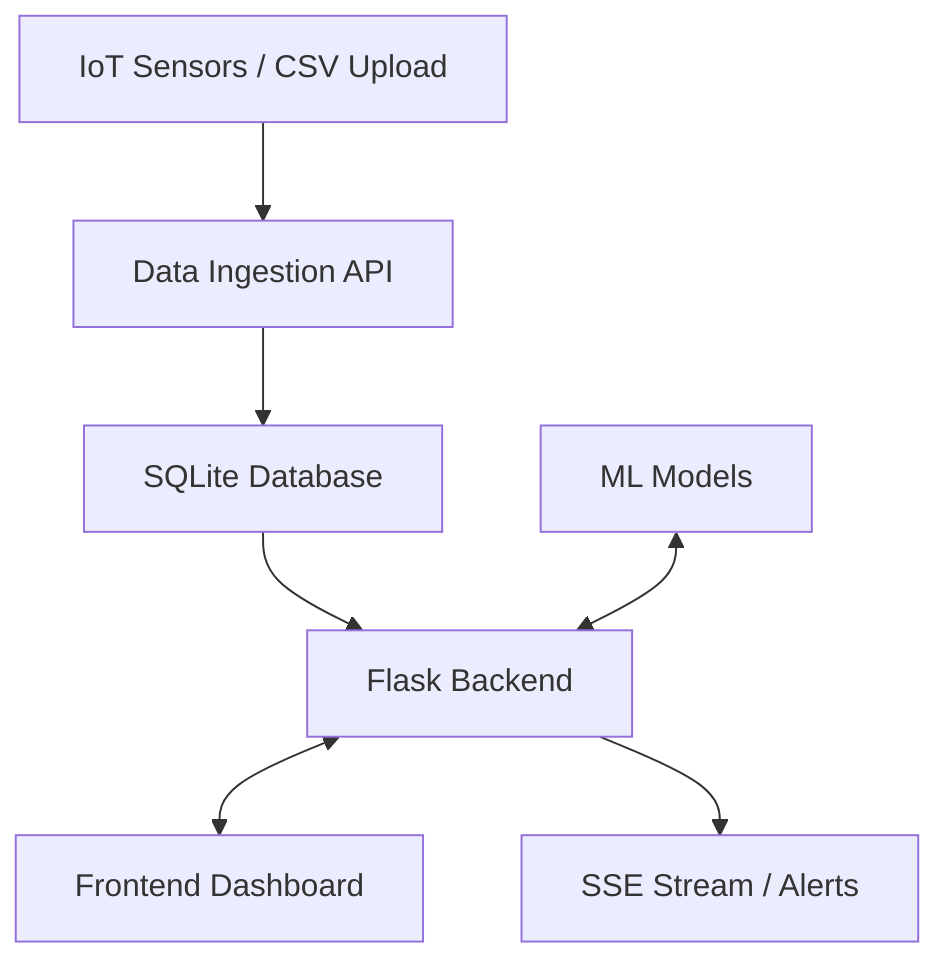

# Digital Twin CO₂ Monitor (DTCM)


## Project Description

The Digital Twin CO₂ Monitor (DTCM) is a full-stack software system designed to track, model, and predict carbon dioxide (CO₂) levels within various indoor environments or urban zones. By leveraging a Digital Twin architecture, the system creates a virtual representation of physical spaces, allowing for real-time monitoring, predictive modeling, and automated alerts for poor air quality.

## Architecture Diagram



## Features List

- **Real-Time Data Ingestion:** Process sensor readings natively or via CSV imports.
- **Machine Learning Integration:**
  - Linear Regression & Random Forest for CO₂ short-term predictions.
  - Decision Trees for categorizing zone air quality.
- **Alerting System:** Triggers alerts at configurable thresholds (Warning = 450ppm, Critical = 500ppm).
- **Digital Twin State:** Query real-time "twin" snapshots of all tracked zones.
- **Authentication & Authorization:** JWT-based user sessions with role-based access control (General, Researcher, Administrator, Environmental Authority).
- **Server-Sent Events (SSE):** Push active alerts in real-time to the frontend dashboard.

## Prerequisites

- Python 3.9+
- pip (Python package installer)
- Virtual Environment (recommended)

## Quick Start

1. **Clone the repository and enter the directory:**
   ```bash
   cd "D:\project 1\dtcm"
   ```

2. **Create and activate a virtual environment:**
   ```bash
   python -m venv venv
   # Windows
   venv\Scripts\activate
   # macOS/Linux
   source venv/bin/activate
   ```

3. **Install dependencies:**
   ```bash
   pip install -r requirements.txt
   ```

4. **Initialize the database:**
   ```bash
   flask db upgrade
   ```

5. **Run the Flask application:**
   ```bash
   flask run
   ```
   The application will be available at `http://127.0.0.1:5000`.

## API Reference

All API routes are prefixed with `/api`.

- **Auth:** `/api/auth/register`, `/api/auth/login`
- **Sensors:** `/api/sensors/live`, `/api/sensors/history`
- **Alerts:** `/api/alerts`, `/api/alerts/<id>/acknowledge`
- **Digital Twin:** `/api/twin/state`
- **Machine Learning:** `/api/ml/predict`, `/api/ml/classify`
- **SSE Stream:** `/api/stream`

## Project Structure

```
D:\project 1\dtcm\
├── app.py                 # Application factory
├── config.py              # Configuration loading
├── dtcm/
│   ├── models/            # SQLAlchemy database models
│   ├── routes/            # Blueprint API routes
│   ├── ml/                # ML training and prediction logic
│   └── ingestion.py       # Data ingestion utilities
├── frontend/              # Static HTML/JS/CSS files
├── models/                # Saved serialized .pkl ML models
├── logs/                  # Application logs
├── tests/                 # Pytest test suite
└── README.md              # Project documentation
```

## ML Models

Pre-trained machine learning models are located in `D:\project 1\dtcm\models\`.
- Linear Regression/Random Forest for numerical predictions.
- Scaler is saved at `D:\project 1\dtcm\models\scaler.pkl`.

## Configuration Reference

Configuration is managed via `.env` files using `python-dotenv`.

| Variable | Description | Default |
|----------|-------------|---------|
| `DATABASE_URL` | SQLAlchemy connection string | `sqlite:///dtcm.db` |
| `SECRET_KEY` | Flask app secret key | (Required in production) |
| `JWT_SECRET_KEY` | JWT authentication key | (Required in production) |

## Running Tests

Tests are written using `pytest`.

```bash
pytest tests/
```

## Production Deployment

For production deployments:
1. Ensure `.env` variables contain strong, secure keys.
2. Use a production WSGI server such as `gunicorn` or `waitress`.
   ```bash
   pip install waitress
   waitress-serve --port=5000 --call "app:create_app"
   ```
3. Use an enterprise-grade database (e.g., PostgreSQL) instead of SQLite by updating `DATABASE_URL`.

## License

This project is licensed under the MIT License. See the LICENSE file for details.
